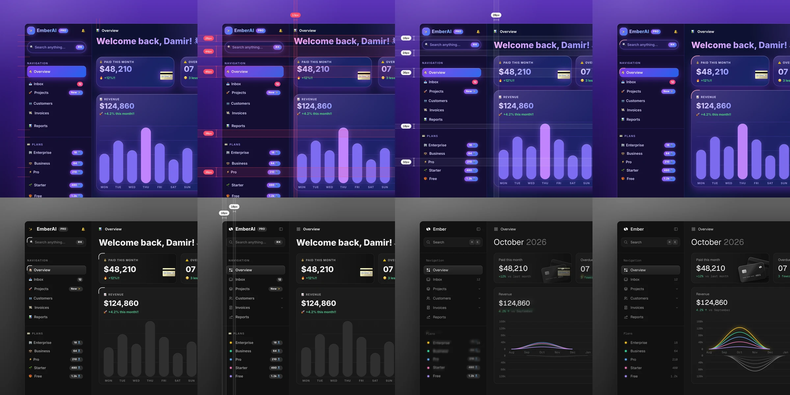

# Unslop Korean

한국어 · [English](README.en.md)

[Damir Sokolovsky](https://x.com/heydamir)의 [unslop](https://github.com/heydamir/unslop)을 기반으로, 영어 윤문 기준을 한국어 기준으로 교체한 포크입니다. 화면을 점검하고 디자인 방향을 정한 뒤 9단계로 개선하는 원본의 작업 방식과 캡처·영상 도구를 그대로 사용합니다.



## 설치

Claude Code에서는 스킬 폴더를 복사하세요. 현재 프로젝트에서만 사용하려면 `~/.claude/skills/` 대신 `.claude/skills/`를 사용합니다.

```sh
git clone https://github.com/jingjing2222/unslop-korean
mkdir -p ~/.claude/skills
cp -r unslop-korean/skills/unslop-korean ~/.claude/skills/
```

Codex에서는 다음과 같이 요청하거나, 같은 폴더를 `~/.agents/skills/`에 복사하세요.

```text
$skill-installer install https://github.com/jingjing2222/unslop-korean/tree/main/skills/unslop-korean
```

Codex·Claude Code 플러그인으로도 설치할 수 있습니다. 공식 플러그인 목록에는 등록되어 있지 않습니다.

웹사이트 화면을 저장하거나 개선 전후를 영상으로 만들 때는 Node.js와 Playwright가 필요합니다. 이 기능을 사용할 프로젝트에서 아래 명령을 실행하세요. 영상을 만들려면 ffmpeg도 설치하고 터미널에서 실행할 수 있도록 PATH에 추가해야 합니다.

```sh
pnpm add -D playwright
pnpm exec playwright install chromium
```

## 사용

Claude Code에서는 `/unslop-korean`, Codex에서는 `$unslop-korean`으로 요청하세요.

```text
/unslop-korean 이 대시보드를 다듬어 줘.
/unslop-korean 이 랜딩 페이지를 다듬고 전후 영상을 만들어 줘.
```

화면을 점검하고 제품에 맞는 방향을 정한 뒤 간격·색·아이콘·문구·글꼴·배치·세부 요소·비주얼·모션 순서로 개선합니다. 이미 잘 만들어진 화면은 필요한 부분만 고칩니다.

한국어 문구는 사용자가 하려는 일, 앞서 받은 안내, 다음 행동과 실제 결과를 확인하며 다듬습니다. [UX·한국어 자료](docs/evidence/README.md)를 참고하되 각 기준의 적용 범위와 예외를 함께 살핍니다. 영어의 금칙어나 문장부호 규칙을 한국어에 그대로 적용하지 않으며, 다른 언어와 한국어 문장에 섞인 외국어 표기는 유지합니다. 한국어 문구만 요청하면 디자인을 바꾸지 않습니다.

[스킬 지침](skills/unslop-korean/SKILL.md) · [원본 예제](examples) · [개발·검증](docs/development.md)

## 출처와 라이선스

원본 unslop은 Damir Sokolovsky가 만들었습니다. 원본의 디자인 지침·이미지·스크립트·예제와 이를 수정한 파일에는 [CC BY 4.0](skills/unslop-korean/LICENSE-CC-BY-4.0)이, 독립적으로 작성한 한국어 기준과 검증 코드에는 [MIT](skills/unslop-korean/LICENSE-MIT)가 적용됩니다. 외부 근거 문서는 각각의 이용 조건을 따릅니다. [출처와 변경 범위](skills/unslop-korean/UPSTREAM.md)를 확인하세요.
