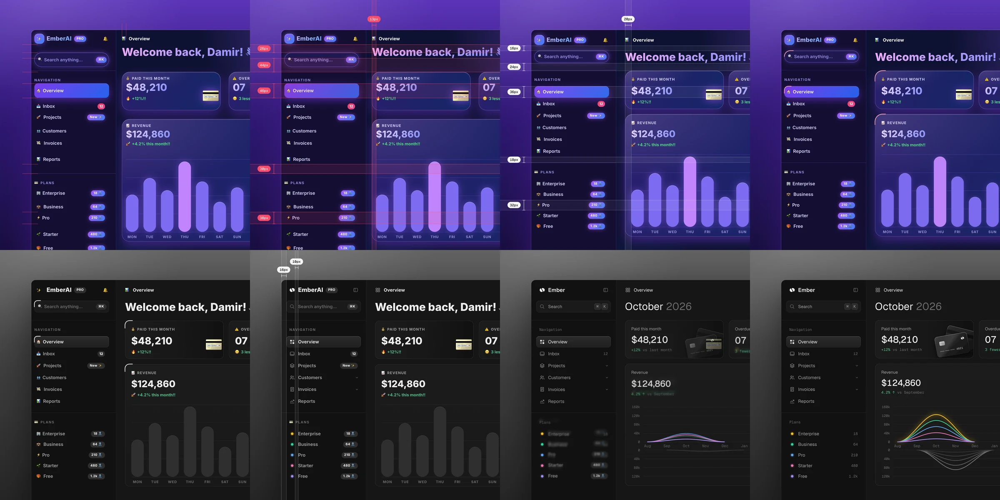

# Unslop Korean

한국어 · [English](README.en.md)

Unslop Korean은 제품의 성격에 맞게 화면을 다듬고, 사용자가 다음에 할 일을 알 수 있도록 한국어 문구를 고치는 스킬입니다. Damir Sokolovsky의 [unslop](https://github.com/heydamir/unslop)을 포크해 원본의 디자인 작업 방식과 캡처·영상 도구를 유지하고, 영어 문구 편집 기준을 한국어에 맞는 기준으로 바꿨습니다.



## 사용법

Codex에서는 `$unslop-korean`, Claude Code에서는 `/unslop-korean` 뒤에 원하는 작업을 적으세요.

```text
$unslop-korean 결제 화면에서 버튼을 누르면 어떤 일이 일어나는지 알 수 있게 한국어 문구만 다듬어 줘.
```

```text
/unslop-korean 이 랜딩 페이지를 다듬고, 바꾸기 전과 후를 영상으로 보여 줘.
```

화면 전체를 맡기면 먼저 어디를 손볼지 살핍니다. 크게 고쳐야 할 때는 제품에 어울리는 방향을 정하고 간격, 색상, 아이콘, 문구, 글꼴, 배치, 세부 요소, 이미지, 움직임 순서로 다듬습니다. 이미 방향이 잘 잡힌 화면은 어색한 부분만 고칩니다.

한국어 문구만 요청하면 현재 디자인을 유지합니다. 사용자가 앞에서 어떤 안내를 받았는지, 버튼을 누르면 실제로 어떤 일이 일어나는지 확인해 그 흐름에 맞게 표현을 고칩니다. 한국어 문장에 섞인 외국어 표기와 다른 언어로 쓴 문구는 보존합니다. 문구를 검토할 때 참고하는 자료와 각 기준의 적용 범위는 [한국어·UX 자료](docs/evidence/README.md)에서 확인할 수 있습니다.

## 설치

### Codex

Codex 대화창에 아래 요청을 입력하세요. 직접 설치하려면 이 저장소의 `skills/unslop-korean` 폴더를 `~/.agents/skills/` 아래에 복사하세요.

```text
$skill-installer install https://github.com/jingjing2222/unslop-korean/tree/main/skills/unslop-korean
```

### Claude Code

터미널에서 아래 두 명령을 실행한 뒤 새 Claude Code 세션을 여세요.

```sh
claude plugin marketplace add jingjing2222/unslop-korean
claude plugin install unslop-korean@unslop-korean
```

### Google Antigravity

저장소를 내려받고 스킬 폴더를 Google Antigravity의 전역 스킬 디렉터리에 복사하세요.

```sh
git clone https://github.com/jingjing2222/unslop-korean
mkdir -p ~/.gemini/config/skills
cp -r unslop-korean/skills/unslop-korean ~/.gemini/config/skills/
```

### 화면 캡처와 영상 제작

웹페이지나 로컬 HTML 파일을 캡처하려면 Node.js가 필요합니다. 작업할 프로젝트에서 Playwright와 Chromium을 설치하세요.

```sh
pnpm add -D playwright
pnpm exec playwright install chromium
```

변경 과정을 영상으로 만들려면 ffmpeg도 설치하세요. 터미널에서 `ffmpeg -version`을 실행하면 설치 상태를 확인할 수 있습니다.

[스킬 지침](skills/unslop-korean/SKILL.md) · [원본 예제](examples) · [개발 및 검증 방법](docs/development.md)

## 출처와 라이선스

원본 unslop의 디자인 지침, 이미지, 스크립트, 예제와 이를 수정한 파일에는 [CC BY 4.0](skills/unslop-korean/LICENSE-CC-BY-4.0)이 적용됩니다. 이 프로젝트에서 작성한 한국어 기준과 검증 코드는 [MIT 라이선스](skills/unslop-korean/LICENSE-MIT)를 따릅니다. 외부 참고 자료는 각 자료의 이용 조건을 따릅니다. 원본에서 가져온 파일과 수정한 내용은 [출처와 변경 내역](skills/unslop-korean/UPSTREAM.md)에 정리했습니다.
